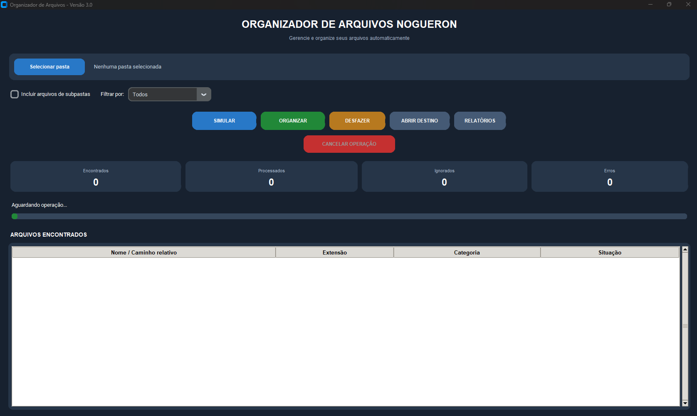

# Organizador de Arquivos

Aplicação desktop desenvolvida em Python para automatizar a organização de arquivos em pastas por categoria. Possui interface gráfica intuitiva, simulação de operações, relatórios e histórico de movimentações.

## 🖥️ Demonstração



## 🚀 Funcionalidades

- Interface gráfica com Tkinter e CustomTkinter.
- Seleção da pasta de origem.
- Organização automática de arquivos por categoria.
- Separação de imagens, documentos, planilhas, PDFs e outros formatos.
- Filtros por categoria e extensão.
- Opção para incluir subpastas.
- Simulação antes da movimentação real.
- Barra de progresso durante a execução.
- Cancelamento de operações.
- Relatórios detalhados das movimentações.
- Cópia do relatório para a área de transferência.
- Histórico de operações.
- Função para desfazer a última organização.
- Abertura da pasta de destino.

## 🛠️ Tecnologias utilizadas

- **Python 3**
- **Tkinter** – interface gráfica.
- **CustomTkinter** – componentes visuais.
- **Pathlib** – manipulação de caminhos e arquivos.
- **Shutil** – operações com arquivos.
- **JSON** – armazenamento do histórico.
- **Threading** – execução de tarefas em segundo plano.

## 📁 Estrutura do projeto

```text
OrganizadorPython/
│
├── interface.py
├── organizador.py
├── requirements.txt
├── README.md
├── .gitignore
│
└── imagens/
    └── tela_principal.png
```

## ⚙️ Instalação

**1. Instale o Python**

Baixe e instale o Python pelo site oficial:

https://www.python.org/downloads/

**2. Clone o repositório**

```bash
git clone https://github.com/SEU_USUARIO/SEU_REPOSITORIO.git
```

**3. Entre na pasta do projeto**

```bash
cd SEU_REPOSITORIO
```

**4. Instale as dependências**

```bash
python -m pip install -r requirements.txt
```

## ▶️ Como executar

Inicie a aplicação com:

```bash
python interface.py
```

## 📖 Como utilizar

1. Selecione a pasta que deseja organizar.
2. Configure os filtros por categoria ou extensão, se necessário.
3. Escolha se deseja incluir subpastas.
4. Execute uma simulação para visualizar os destinos dos arquivos.
5. Confira o relatório da simulação.
6. Execute a movimentação real.
7. Se necessário, utilize a função **DESFAZER** para reverter a última movimentação registrada.

**Recomendação:** sempre execute uma simulação antes de realizar a movimentação definitiva.

## 🎯 Objetivo do projeto

Este projeto foi desenvolvido para aprimorar conhecimentos práticos em Python, incluindo:

- Desenvolvimento de interfaces gráficas.
- Manipulação e gerenciamento de arquivos.
- Modularização de código.
- Tratamento de exceções.
- Persistência de dados.
- Execução de tarefas em segundo plano.
- Desenvolvimento de aplicações desktop.

## 📌 Status do projeto

- Interface: versão 3.0.
- Módulo de organização: versão 3.1.
- Testes de movimentação e desfazer realizados com sucesso.

Projeto desenvolvido para fins de aprendizado e composição de portfólio profissional.